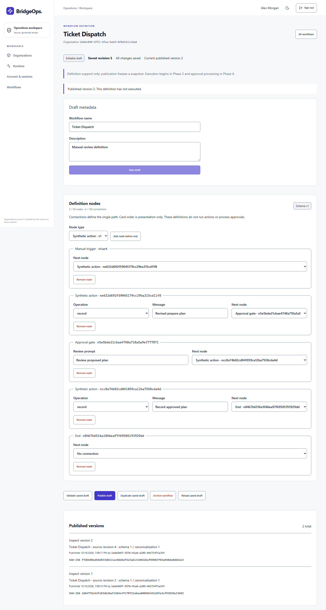

# BridgeOps

A Java/Spring Boot and React operations workspace for governed workflow automation.

**Current work: Phase 2 workflow drafts, validation and immutable publication.** Phase 1D onboarding/sessions/recovery is complete. Workflow backend and form editor are implemented, with required real-browser/container/release verification in progress. Definitions can be saved, validated, published, inspected, duplicated and archived; publication does not execute anything. Execution, integrations, approval processing, AI and MCP remain later phases. See [current evidence](docs/PROJECT_STATUS.md) and [the workflow guide](docs/development/PHASE_2_WORKFLOWS.md).

## Start from a clean checkout

Prerequisites: Docker Engine/Desktop with Compose 2.24+ and PowerShell 7. Host Java/Node are unnecessary for the container startup. Run from repository root:

```powershell
./scripts/setup-local.ps1
./scripts/setup-auth.ps1
docker compose --env-file .env -f infra/compose.yaml config --quiet
docker compose --env-file .env -f infra/compose.yaml up --build -d --wait --wait-timeout 180
```

Open [BridgeOps](http://localhost:8088). Setup creates unique ignored .env database credentials and ignored signing material; it refuses to overwrite existing files. For an existing workspace, retain .env, keys and volumes; run setup-auth only if authentication material has never been configured. Setup/startup creates no account or tenant. Never commit credentials or keys. Port 8088 is localhost-only; BRIDGEOPS_PORT can be set in .env. The browser uses relative URLs through the same-origin proxy.

For an existing installation with its first account already provisioned, run only Compose config/build/start with the existing environment and volume. Do not repeat bootstrap, reset the consumed marker or recreate credentials to upgrade to V9.

### Provision the first account explicitly

After services/migrations are ready, an operator runs:

```powershell
docker compose --env-file .env -f infra/compose.yaml run --rm -e BOOTSTRAP_ENABLED=true -e BOOTSTRAP_EMAIL=your-email@example.com -e BOOTSTRAP_DISPLAY_NAME=YourName bootstrap
```

Replace the nonsensitive metadata; enter your own password through the no-echo console. Never pass a password argument or literal secret in shell history. Protected automated stdin, exit codes and operator-credential requirements are documented in the [bootstrap guide](docs/development/PHASE_1C_ONBOARDING.md). Bootstrap is disabled by default, one-shot and transactionally locked. It creates one verified account with an account-level organization.create grant, no tenant. Normal startup never provisions an identity. Do not reset the consumed marker to bypass this policy.

Sign in at [the browser sign-in page](http://localhost:8088/sign-in), create an organization and open its members/roles/invitations. Only current permitted actions appear; the backend rechecks authorization, delegation, revisions and last-active-Owner protection. Organization membership does not grant the account-level ability to create other organizations.

Current secure-context browsers with Web Locks are required (HTTPS or loopback development). Access credentials stay in memory, refresh credentials stay in HttpOnly cookies, cookie-sensitive sequences are serialized across tabs, and broadcasts contain no credentials. Account & sessions offers password change, this-browser sign-out and logout-all; no individual remote-session list is claimed.

### Invitations and recovery email

SMTP is disabled unless explicitly configured. Add external INVITATION_SMTP_ENABLED/HOST/PORT/USERNAME/PASSWORD/FROM/SSL settings to the ignored environment; blank examples and required TLS behavior are in the [configuration guide](docs/development/PHASE_1C_ONBOARDING.md). These compatibility settings now configure the shared transport used by invitations and identity recovery. Recreate the backend after configuration. No real SMTP credentials/connectivity or real-recipient delivery was used for implementation verification.

Existing recipients sign in and choose Accept an invitation. First-time recipients choose Join with an invitation, paste the emailed proof into the form, enroll and then explicitly sign in. Tokens never belong in URLs. Invitation issue reports unavailable delivery as an error.

Forgot your password opens recovery request; I have a recovery token opens manual reset. Recovery requires an ACTIVE verified account and working external delivery. Public responses are generic and never confirm that an email was sent. The bounded volatile dispatcher may lose/drop work on failure, saturation or shutdown; there is no durable outbox or automatic retry. If no message arrives, retry within quotas or contact the operator. Recovery proofs expire in 15 minutes and are consumed once. Successful password change/reset revokes all sessions and outstanding proofs. [Exact contracts, tests and limitations](docs/development/PHASE_1D_BROWSER.md).

## Build and verify

Host verification needs Java 21, Node **24.22.0**, a working Docker daemon and Chromium. Missing browser/database prerequisites fail rather than silently skip. Build frontend assets before the Maven verify lifecycle:

```powershell
npm.cmd --prefix frontend ci --no-audit --no-fund
npm.cmd --prefix frontend run typecheck
npm.cmd --prefix frontend run lint
npm.cmd --prefix frontend test
npm.cmd --prefix frontend run build
npm.cmd --prefix frontend exec -- playwright install chromium
./backend/mvnw.cmd -f backend/pom.xml -B -ntp verify
node scripts/verify-docs.mjs
```

On Linux/macOS use npm and ./backend/mvnw; install unzip and a SHA-256 tool. Chromium may require OS packages: npm exec -- playwright install --with-deps chromium from frontend. CI installs these prerequisites and runs the browser journey as part of Maven verification.

The browser test explicitly bootstraps an isolated Testcontainers database, uses the real API and built frontend, and captures mail only through a secret-protected loopback test gateway in test sources. It creates no persistent local account, contacts no external SMTP provider and never installs a production fake-mailbox route. Generated diagnostics/screenshots remain under ignored backend/target/browser-checks. It does not establish WCAG conformance or a production security audit.

This workspace has an ignored checksum-verified Node runtime under .tools/node-v24.22.0-win-x64. Add it to PATH for frontend commands. When the host's default Node differs, set BRIDGEOPS_TEST_NODE to the absolute pinned node executable before Maven verify. A clean checkout uses an official Node 24.22.0 installation. Windows test sockets use a canonical ignored target directory to avoid JDK short-TEMP-path selector failures; no OS networking setting is changed.

## Operate the development stack

```powershell
Invoke-RestMethod http://localhost:8088/api/v1/system/info
Invoke-RestMethod http://localhost:8088/health/liveness
Invoke-RestMethod http://localhost:8088/health/readiness
docker compose --env-file .env -f infra/compose.yaml ps
docker compose --env-file .env -f infra/compose.yaml down
```

Named database volumes survive down. Rebuild with up --build -d --wait after source changes. Changing .env does not rotate existing database-role passwords. Never delete volumes/reset accounts to make verification pass.

Liveness is independent of PostgreSQL; readiness includes it. Public probe output is minimal. Management/OpenAPI paths are hidden by default. For explicit local documentation access use infra/compose.docs.yaml in addition to the main Compose file; Swagger/API docs appear on localhost:8081. Vite development proxies to that backend; set the ignored AUTH_ORIGIN to the exact Vite origin and recreate the backend. Only one browser origin is trusted at a time.

The local Compose backend receives startup migration credentials. Production must separate migrations/operator execution, inject secrets safely and use HTTPS/Secure cookies. Runtime database grants remain restricted; they do not contain a compromised process holding migration credentials. No license, verified private reporting channel, production deployment, SSO/MFA, backup/restore, load/HA, accessibility conformance or complete security certification is claimed.

## Architecture and delivery

- [Current project status and verified publication](docs/PROJECT_STATUS.md)
- [Workflow definition schema, revisions and immutable publication](docs/development/PHASE_2_WORKFLOWS.md)
- [Browser/session/recovery guide](docs/development/PHASE_1D_BROWSER.md)
- [HTTP authentication and keys](docs/development/PHASE_1B_HTTP_AUTH.md)
- [Offline bootstrap and invitation configuration](docs/development/PHASE_1C_ONBOARDING.md)
- [Implemented and planned API contracts](docs/api/CONTRACT_OUTLINE.md)
- [System architecture](docs/architecture/SYSTEM.md), [database](docs/architecture/DATABASE.md) and [threat model](docs/security/THREAT_MODEL.md)
- [Design foundation](docs/design/FOUNDATION.md), [implementation sequence](docs/development/PHASE_1_IMPLEMENTATION.md) and [backlog](docs/product/BACKLOG.md)
- [Git workflow](docs/development/GIT_WORKFLOW.md), [credential rotation](docs/security/LOCAL_CREDENTIAL_ROTATION.md) and [security reporting](SECURITY.md)

The modular monolith and locked Java 21 / Boot 4.1.1 / Maven Wrapper 3.9.16 / PostgreSQL 18.6 / React/TypeScript baseline are retained. Development repository: [ChouaibSeishin/BridgeOps](https://github.com/ChouaibSeishin/BridgeOps). Hosted checks are reported only after actual completion. Next roadmap work is Phase 2 draft workflow persistence/validation/publication; execution, integration adapters and AI remain later.

## Browser preview

Actual Phase 2 editor/API with disposable test accounts and two immutable published definitions, captured during the required Chromium journey. Publication has not executed any workflow. These are not local user accounts or fabricated dashboard data. [Mobile](docs/screenshots/phase2-workflow-mobile.png) and [dark theme](docs/screenshots/phase2-workflow-dark.png).


