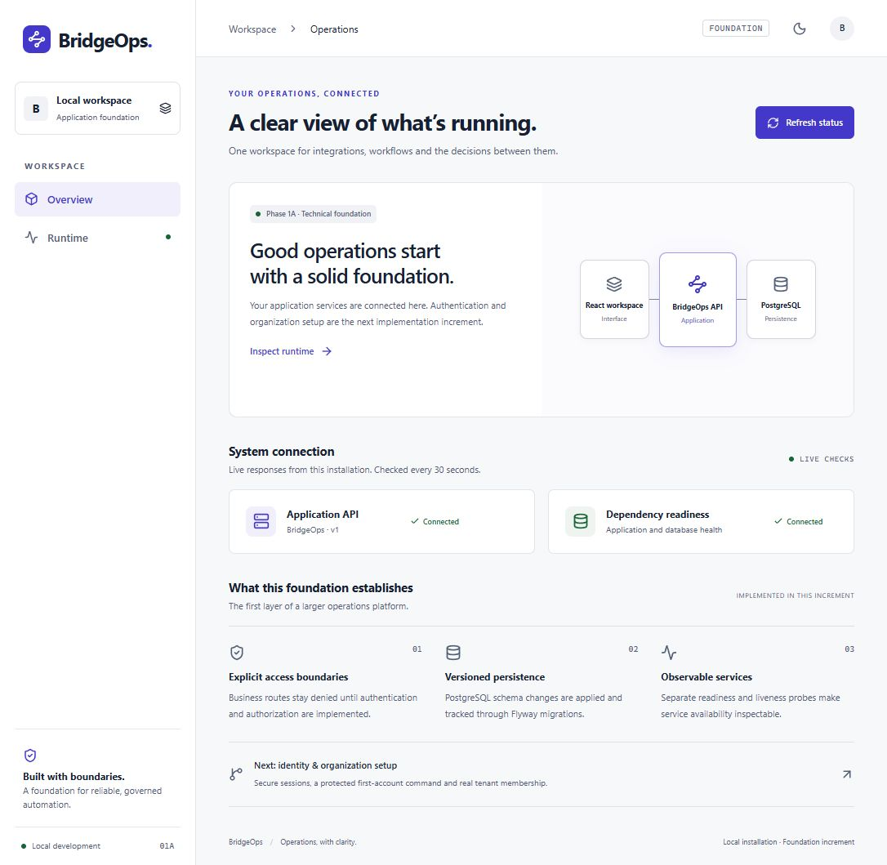

# BridgeOps

A modular Java/Spring Boot and React operations platform for governed workflow automation.

**Current checkpoint: Phase 1C backend onboarding.** Offline one-shot bootstrap, organization/Owner creation, tenant-bound membership permissions, last-Owner protection and recipient-bound SMTP invitations are implemented. The frontend remains the foundation status shell. Browser sign-in/onboarding, recovery, workflows, integrations, AI and MCP remain planned. See [current verification evidence](docs/PROJECT_STATUS.md).

The [conflict-resolution report](docs/CONFLICT_RESOLUTION.md) records the reviewed decisions. The [implementation sequence](docs/development/PHASE_1_IMPLEMENTATION.md), [technology lock](docs/development/TECHNOLOGY.md) and [backlog](docs/product/BACKLOG.md) govern the next work. The [master specification](docs/product/MASTER_PROJECT_PROMPT.md) is retained with explicit amendments.

## Start locally

Prerequisites: Docker Engine/Desktop with Compose 2.24+ and PowerShell 7. Host Java/Node are unnecessary for the full container startup. Commands below run from the repository root.

```powershell
./scripts/setup-local.ps1
./scripts/setup-auth.ps1
docker compose --env-file .env -f infra/compose.yaml config --quiet
docker compose --env-file .env -f infra/compose.yaml up --build -d --wait --wait-timeout 180
```

Open [the local workspace](http://localhost:8088). Setup generates unique local database secrets in ignored .env and refuses to overwrite an existing file. .env.example contains empty placeholders only. Auth setup generates separate ignored local RSA/CSRF key files and refuses to replace existing material. For an existing checkout with .env, run only setup-auth.ps1 once. Change BRIDGEOPS_PORT in .env if 8088 is occupied; adjust URLs accordingly. Bindings are localhost-only; only the frontend is published. No paid AI key is required.

Port 8088 is the default because this Windows host rejected binding to 8080. No existing service was stopped to claim that port.

The first PostgreSQL startup creates distinct migration/runtime roles. Flyway applies V1 technical metadata, V2 identity/session schema and V3 bounded authentication throttles using the migration role. The runtime role remains read-only for technical metadata; V2 grants the specific session/account DML needed by the internal service and insert/read-only security events. Existing database volumes retain their role passwords: changing .env does not rotate existing database roles.

## Verify and operate

```powershell
Invoke-RestMethod http://localhost:8088/api/v1/system/info
Invoke-RestMethod http://localhost:8088/health/liveness
Invoke-RestMethod http://localhost:8088/health/readiness
docker compose --env-file .env -f infra/compose.yaml ps
docker compose --env-file .env -f infra/compose.yaml logs --tail 100 backend
docker compose --env-file .env -f infra/compose.yaml down
```

Liveness checks the application process; readiness includes PostgreSQL. Public probe output is minimal. `/api/v1/system/info` returns `{name,apiVersion}`. The implemented /api/v1/auth routes are described in [the HTTP guide](docs/development/PHASE_1B_HTTP_AUTH.md); every other business route remains denied. The browser uses relative URLs through a same-origin proxy; it never receives internal container hostnames or secrets. Named database volumes survive `down`. Rebuild using `up --build -d --wait` after source changes.

To reset **disposable development data only**, stop services and explicitly run `docker compose --env-file .env -f infra/compose.yaml down --volumes`. This deletes this Compose project's database volume; never use it for data you need to keep. Normal verification does not delete existing volumes.

## Builds and tests

Use Java 21 and Maven Wrapper for backend commands. Integration tests require a working Docker daemon; they fail rather than silently skip when it is missing.

```powershell
./backend/mvnw.cmd -f backend/pom.xml -B -ntp verify
```

On Linux/macOS install unzip and a SHA-256 tool, then use `cd backend` and `./mvnw -B -ntp verify`. The wrapper checksum targets the ZIP; without unzip this wrapper switches archive formats. `test` runs unit/MVC security tests; `verify` also runs PostgreSQL/Flyway/OpenAPI integration tests. Container builds skip tests because CI runs them separately; an image build alone is not test evidence.

Frontend requires Node **24.22.0** (global 20.17.0 is incompatible). With that runtime on PATH:

```powershell
npm.cmd --prefix frontend ci --no-audit --no-fund
npm.cmd --prefix frontend run typecheck
npm.cmd --prefix frontend run lint
npm.cmd --prefix frontend test
npm.cmd --prefix frontend run build
node scripts/verify-docs.mjs
```

The current workspace also has a checksum-verified untracked runtime in `.tools/node-v24.22.0-win-x64`; it is not part of a clean checkout. To use it in this workspace:

```powershell
$env:PATH = (Join-Path $PWD '.tools/node-v24.22.0-win-x64') + ';' + $env:PATH
```

A fresh checkout may instead use the official Node 24.22.0 installer or the pinned Node build image. Lockfiles and wrapper distribution/checksum make dependency resolution reproducible. The [verification plan](docs/development/PHASE_1_VERIFICATION.md) lists failure and security checks. CI configuration is committed; a hosted CI run is not implied.

## API documentation and frontend development

Public Compose routing hides management and OpenAPI paths by default. To opt in locally:

```powershell
docker compose --env-file .env -f infra/compose.yaml -f infra/compose.docs.yaml up -d --wait
```

Open [Swagger UI](http://localhost:8081/swagger-ui.html) or [OpenAPI JSON](http://localhost:8081/v3/api-docs). The override exposes the backend only on localhost:8081 and enables docs; omit it for ordinary startup. Documentation describes implemented routes only. `npm.cmd --prefix frontend run dev` serves the development client, proxying API/health requests to that backend on 8081. Keep the core Compose services running. No production TLS deployment is performed by this setup.

## Bootstrap and security boundary

The chosen design provisions one initial account through an explicit offline, one-shot command. That account logs in and creates its organization/Owner membership transactionally; subsequent users join by invitation. **The offline bootstrap command is implemented; the sign-in UI remains Phase 1D.** Compose enables authentication, but normal startup seeds no account or tenant. Use [the Phase 1C operator/API guide](docs/development/PHASE_1C_ONBOARDING.md) for explicit provisioning and SMTP configuration. There are no seed credentials, privileged HTTP bootstrap endpoint, production default account or working sign-in controls. Phase 1B/C implements and tests the [bootstrap lifecycle](docs/architecture/adr/0014-offline-bootstrap.md) and [session strategy](docs/architecture/adr/0002-browser-sessions.md).

No private security-reporting method currently exists; [SECURITY.md](SECURITY.md) describes the public-release gate. No WCAG, production security, hosted deployment or workflow correctness claim is made for this foundation.

## Architecture and product documents

- [Requirements and scope](docs/product/REQUIREMENTS.md)
- [System/module architecture and component diagram](docs/architecture/SYSTEM.md)
- [Execution/state/approval sequence](docs/architecture/EXECUTION.md)
- [Database relationships](docs/architecture/DATABASE.md)
- [Threat model and permissions](docs/security/THREAT_MODEL.md)
- [Implemented versus planned API contract](docs/api/CONTRACT_OUTLINE.md)
- [Design tokens and layout direction](docs/design/FOUNDATION.md)
- [ADRs](docs/architecture/adr/README.md)
- [Repository structure](docs/development/REPOSITORY.md)

Next: Phase 1D real browser sign-in/onboarding, session coordination and recovery. The first workflow/approval business demonstration follows Phases 2–4; full integrations/webhooks, AI/MCP and delivery polish remain in the revised roadmap.

## Actual foundation preview

Captured from the running local application, not a mockup. [Mobile dark-theme capture](docs/screenshots/foundation-mobile-dark.jpg). These captures do not establish accessibility conformance.



## Incremental GitHub development

The public development repository is [ChouaibSeishin/BridgeOps](https://github.com/ChouaibSeishin/BridgeOps). Publication status is recorded in PROJECT_STATUS.md; a URL alone does not prove a push succeeded. Follow the [Git workflow](docs/development/GIT_WORKFLOW.md) and [local credential rotation guide](docs/security/LOCAL_CREDENTIAL_ROTATION.md). No license has been selected yet.

The [Phase 1B.1 session-core report](docs/development/PHASE_1B_SESSION_CORE.md) explains replay transactions, concurrency guarantees and the historical internal boundary. The [Phase 1B.2 HTTP guide](docs/development/PHASE_1B_HTTP_AUTH.md) documents the current enabled transport and key configuration.

The [Phase 1C guide](docs/development/PHASE_1C_ONBOARDING.md) documents explicit offline initial-account provisioning. It is disabled by default and creates no tenant; normal startup never provisions an account.
