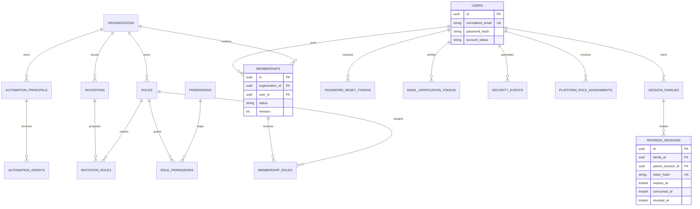
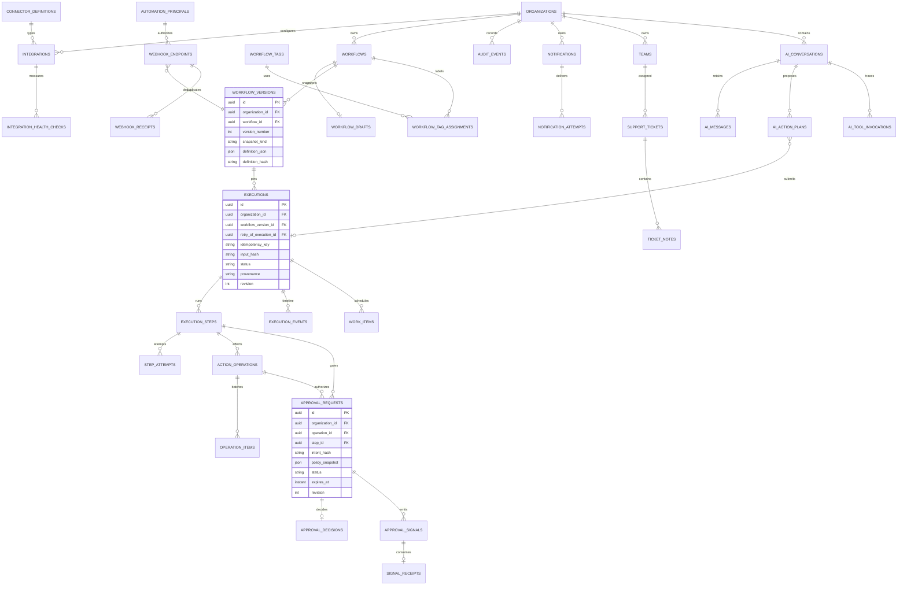

# Proposed relational model

Status: V1–V8 implement foundation/identity/tenant/recovery. V9 workflow/draft/version persistence passed empty-schema and V8-upgrade tests and the additive local Compose upgrade with existing account/installation state preserved. V10 adds the durable internal execution subset below. V11 adds the human-approval subset described below; broader integrations/AI models remain planned. [Exact workflow contract](../development/PHASE_2_WORKFLOWS.md). UUID IDs, UTC timestamptz/Java Instant, explicit nullability/checks and optimistic revisions are defaults. JSON is bounded/schema-versioned and never grants authority.

## Identity and tenancy ER diagram

V11 adds implemented approval_policy_versions, organization_approval_policies, approval_requests and append-only approval_decisions, approval_signals, approval_signal_receipts, approval_invalidations and approval_events. Tenant-qualified foreign keys bind pinned execution/version/hash, gate/action, logical operation/hash and policy. Requests finalize once, with one decision and signal per request and one receipt per signal. Narrow runtime grants deny history mutation and deletion. Fresh V11 and V10 upgrade tests verify preservation, constraints and privileges. The [approval guide](../development/PHASE_4_APPROVALS.md) documents exact fields and acceptance; broader models below remain target design.

Table names use `organization_memberships` for MEMBERSHIPS. Organization roles are tenant-owned copies of fixed templates; platform role assignments are separate. Unique `(organization_id,user_id)` membership and `(organization_id,name)` role. Role assignment and invitation-role joins carry organization IDs and composite foreign keys to prevent foreign-tenant grants. Invitations bind normalized email, token hash and expiry; acceptance proves recipient identity. Serialize last-owner mutations by locking the organization row.

Session families record absolute expiry and revocation. Refresh rows are single-use with a unique successor; consumed hashes remain available for reuse detection until family expiry plus retention. Rotation locks row/family. Reuse revokes the family. Strict concurrent refresh policy may require re-login; frontend serializes refresh calls. Password reset/change and logout-all revoke families. Email normalization is trim plus documented case normalization, identical in application and database uniqueness rules, without provider-specific dot/plus rewriting.

## Workflow, execution and governance ER diagram

EXECUTIONS maps to `workflow_executions`. This diagram omits some repeated organization edges for clarity: every tenant-owned child table carries organization_id, including tickets without an assigned team. Actors may be human users or automation principals with explicit actor_type; do not force automated execution into a fictitious human account.

## Invariants and additions to the prompt

- Composite unique `(organization_id,id)` parent keys and composite foreign keys enforce tenant consistency. Execution binds `(organization_id,workflow_id,workflow_version_id)` to its version. The current-published pointer must reference the same workflow and a PUBLISHED snapshot; enforce with composite keys and a publication guard.
- Separate `workflow_drafts` from immutable `workflow_versions`. Published snapshots reject runtime UPDATE/DELETE through grants and database guards. TEST snapshots have distinct IDs and no published version number. Unique published `(workflow_id,version_number)`.
- Unique `(execution_id,node_id)` step, `(step_id,attempt_number)` attempt and `(execution_id,event_sequence)` event. Attempts preserve retry history rather than overwriting the latest failure.
- `work_items` stores due_at, lease_owner, lease_expires_at, fencing_token and work-key uniqueness. `signal_receipts` makes approval resumption repeat-safe. RabbitMQ outbox tables are added only if a broker is adopted.
- `action_operations` stores canonical intent/hash, logical key and reconciliation status; `operation_items` stores per-ticket preconditions/receipts. Start/side-effect key scopes follow [execution design](EXECUTION.md).
- Unique approval decision per request for the MVP single-approver policy. Future quorum approval requires a revised schema. Changed intent creates a new request; decisions are immutable.
- Webhook receipts have unique `(endpoint_id,delivery_id)` and payload hash. Same delivery ID/different payload is a conflict. Keep receipts 30 days; signature timestamps remain limited to five minutes. Endpoints pin a published version and restricted automation grant.
- Integration secret_reference is an opaque handle; public JSON excludes secret values. Notification receipts deduplicate logical delivery. AI action plans are persisted canonical proposals linked to ordinary executions, never an alternate write authority.
- Sample teams, tickets, notes, notification attempts, policies and automation grants are real domain data. These are explicit additions needed to support the flagship demonstration.

## Index, retention and transaction plan

| Data | Initial indexes | Retention proposal |
| --- | --- | --- |
| Executions | Tenant + created_at/id, tenant + status/created_at | 90-day detail; archive definitions with active references |
| Steps/events | Execution/node, step/attempt, execution/sequence uniqueness | Redacted detailed payloads expire after 30 days |
| Work items | Partial runnable status + due_at | Compact only after reconciliation horizon |
| Approvals | Tenant/status/expires_at | 365-day decision metadata |
| Audit/security | Tenant/time/id and actor/time | 365/90 days respectively |
| Sessions/tokens | Token-hash unique, family, expiry | Keep consumed hashes through reuse-detection horizon |
| AI conversations | Tenant/user/updated_at | Content persistence off by default; opt-in 30 days |
| Operation receipts | Logical keys unique, expiry | At least 30 days after terminal work; unresolved records never purged |

Use restrictive foreign keys for history and soft archive active definitions/integrations. Retention defaults are portfolio policy, not compliance claims. Audit runtime role denies update/delete; separate maintenance role performs documented purges. An ordinary audit table is not tamper-proof. Organization deletion is a staged authorized purge requiring further design before production.

Flyway owns schema; JPA uses ddl-auto=validate. Test migration from empty and prior PostgreSQL schemas. Keep external calls outside database transactions. Use DTO projections, bounded pagination and query-count tests to prevent N+1 behavior. Application-enforced tenancy is mandatory; PostgreSQL row-level security is deferred defense in depth, not an existing guarantee.

## Installation provisioning clarification

Phase 1 introduces a singleton installation_state record with bootstrap_consumed_at and initial_user_id, plus account-level user_grants for organization.create. Offline bootstrap locks the singleton row and atomically creates exactly one verified account and consumes the marker. It creates no organization. Organization creation is an authenticated transaction that checks the account grant and creates Owner membership. Invite acceptance creates no installation-wide grants. This boundary is now implemented by V4/V5/V7; actual verification is recorded in PROJECT_STATUS.md.

Approval uniqueness means one decision-maker per request, distinct from the requester; it does not mean two approvers.

## Implemented identity subset — Phase 1B.1

V2 now implements users, session_families, refresh_sessions and identity_security_events for the internal session core. users currently includes ID, stored/normalized ASCII email, BCrypt hash, display name, active/disabled status and creation time; verification/reset/invitation/account-grant fields remain future migrations. The identity_security_events name distinguishes minimal identity security history from the future organization audit module. Parent uniqueness, parent/family binding and fixed-expiry foreign keys are database-enforced. No user is seeded. Installation bootstrap/membership remains Phase 1C. See [session core](../development/PHASE_1B_SESSION_CORE.md).

Phase 1B.2 V3 adds authentication_throttles: hashed bucket scope, bounded attempt count and expiry index. The service enforces a 10,000-row cap under a PostgreSQL transaction advisory lock and removes expired buckets on acquisition; runtime DML is limited to that table. No browser HTTP session table or account seed is introduced. [HTTP/security details](../development/PHASE_1B_HTTP_AUTH.md).

V4 implements installation_state (singleton, locked consumed marker), user_grants and users.email_verified_at. Offline provisioning is one transaction; the runtime role cannot consume bootstrap state or grant account authority. Tenant/invitation tables remain subsequent Phase 1C increments. [Bootstrap behavior](../development/PHASE_1C_ONBOARDING.md).

V5 implements organizations, organization_memberships, tenant-owned roles, fixed permissions, tenant-qualified role_permissions/membership_roles and insert-only organization_audit_events. Composite foreign keys reject foreign-tenant role assignment. Organization, role templates, Owner membership and creation audit commit atomically; no organization is seeded. Mutation/last-Owner and invitation behavior follow in subsequent increments.

V6 adds column-scoped runtime UPDATE privileges for membership status/revision and organization revision (required for SELECT FOR UPDATE), plus DELETE on membership_roles. Application mutations serialize on the organization parent, use expected membership revision and protect the last active Owner. Memberships are soft-removed so history/foreign keys remain intact. Audit UPDATE/DELETE and account-grant writes remain denied.

V7 implements recipient-bound invitations and tenant-qualified invitation_roles, one pending invitation per tenant/email, hashed credentials and terminal timestamps. Runtime generic users INSERT stays denied. A migration-owned enrollment function validates raw proof, recipient, DB deadline/current issuer grants and role consistency before atomically creating only the invited verified account/membership and consuming the token. Its search path is trusted, relations qualified and PUBLIC EXECUTE revoked. It cannot assign account grants or installation state. [Full invariant/configuration evidence](../development/PHASE_1C_ONBOARDING.md).

V8 implements password_reset_tokens (UUID/user FK, unique SHA-256 token hash, created/absolute expiry/consumed times, one pending proof per account). Runtime may SELECT/INSERT and update consumed_at only. Password change/reset invalidate pending proofs and families atomically with safe identity events. Broader verification-token and execution models above remain planned; V9 implements the workflow definition subset below.

V9 implements workflows, one workflow_drafts row and immutable workflow_versions. Tenant-qualified parent/child/current-pointer keys prevent references to another tenant or workflow. All current version rows are published snapshots; TEST snapshots/execution references remain deferred. Drafts store bounded JSON text to preserve reload order; versions store canonical JSON text, schema/canonicalization version, frozen metadata, source revision and SHA-256 checked against stored bytes by PostgreSQL. Runtime column grants allow only required workflow/draft updates; version UPDATE/DELETE/TRUNCATE is denied and a row trigger rejects modification even by ordinary operator DML. Required safe workflow events extend the existing insert-only organization audit stream with revision/version/hash/correlation metadata. There is no raw graph in audit. The migration changes no existing role mapping, account or bootstrap state.

Fresh-schema and V8-upgrade tests passed with the restricted runtime role. The existing local Compose database was also upgraded additively through V9: account/installation fingerprints remained identical, the consumed marker and one existing user were preserved, and no organization/workflow/version fixture was added. The named volume, environment and signing keys were retained. See [verified evidence](../PROJECT_STATUS.md).

V10 adds workflow_executions, execution_steps, immutable execution_attempts/events, execution_work_items, synthetic_records and execution_operation_receipts. Execution FK includes tenant/workflow/version/hash; retry FK binds the same snapshot and tenant. Steps have unique node/position; attempts and event sequence are unique within their execution/step. Runtime execution updates are column-scoped; database guards reject invalid transitions and any terminal execution update. Record effects/receipts, attempts and events deny runtime UPDATE/DELETE/TRUNCATE and reject ordinary operator row mutation. No retention cleanup runs in Phase 3. Fresh/V9 upgrades preserve account, marker, tenant, roles, draft and published bytes. Local preserved-data upgrade and final release evidence are recorded in [project status](../PROJECT_STATUS.md).
