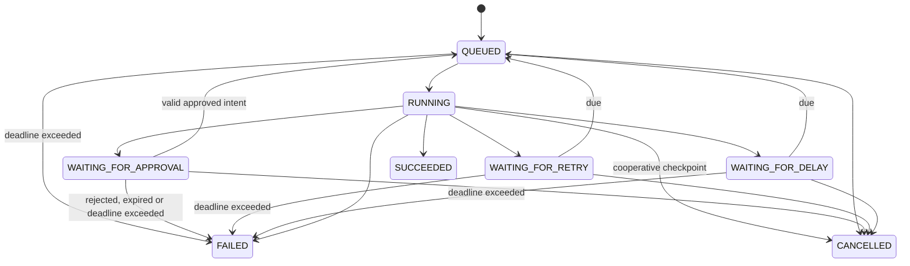
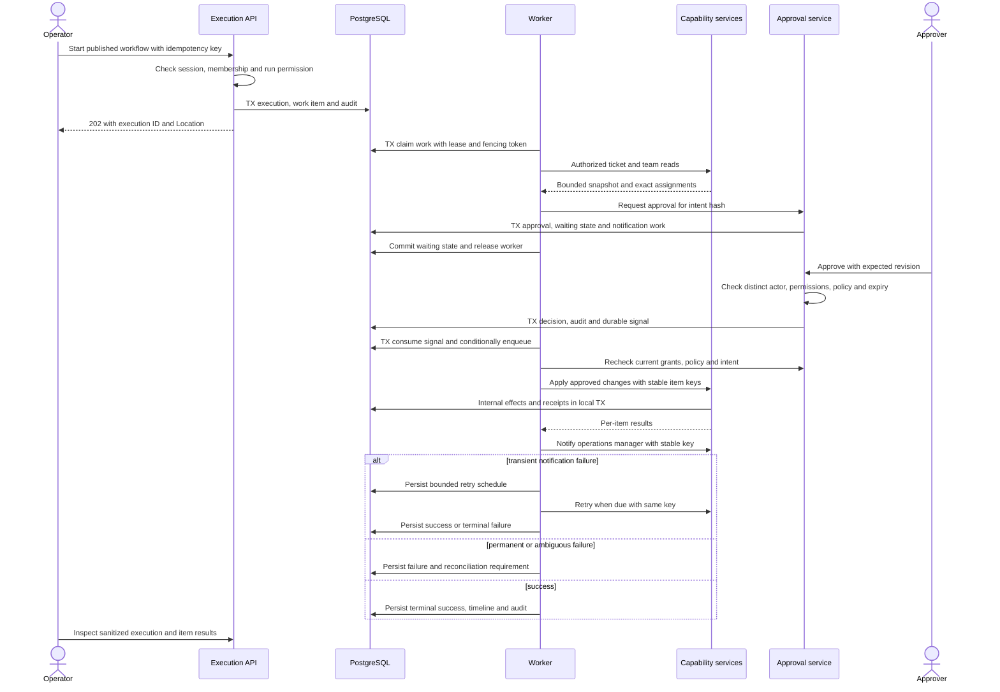

# Execution and approval design

Status: Phase 3 sequential internal runtime implemented; local release gates and corresponding hosted implementation CI passed. The broader approval/integration sequence below remains Phase 4+ target design. [Exact implemented contract](../development/PHASE_3_EXECUTION.md).

Phase 2 implements definition validation/persistence/publication through [the workflow contract](../development/PHASE_2_WORKFLOWS.md). Its schema-v1 registry supports only a connected linear manual-trigger/synthetic-action/approval/end chain. Phase 3 runs manualTrigger, syntheticAction/record and end only, ordered by edges. Approval-containing versions are rejected before submission. Branches, joins, TEST snapshots and approval decisions in the target design below remain deferred. Published definitions never execute merely because publication succeeds.

## Definition and validation

Graph schema: `{schemaVersion,nodes,edges}`. Nodes have stable IDs, registered type versions and typed configuration; UI coordinates are separate presentation data. Reject unknown schema/types/fields, invalid references, cycles, unreachable nodes, incompatible data connections and foreign-tenant connectors. Require exactly one trigger, a reachable end and configured complexity limits. Sequential execution has no parallel forks or ambiguous joins. Conditions select one named branch; unselected paths are skipped. Mutually exclusive branches may converge at a documented selected-predecessor join.

Drafts use optimistic revisions. Publish checks the expected revision, validates, canonicalizes execution JSON and writes an immutable version/hash. A test run pins an immutable TEST snapshot and uses normal execution permissions and approvals. UI label: "Run test — real effects". Show the configured integrations and require explicit confirmation before submission. The API requires effectsAcknowledged=true; false/missing yields 422 before an execution is created. A true dry-run mode is a separate deferred feature.

## State machine

WAITING_FOR_DELAY extends the specification's suggested states. Steps also include pending/skipped and corresponding waiting states. Attempts are separate immutable records. A state machine defines allowed transitions and guards, not just enum values. Terminal executions never resume. Eligible manual retry creates a new execution linked by `retry_of_execution_id`, using the same snapshot and unchanged logical operation receipts. Rejected/expired approvals are not retryable; changed intent needs a new plan and approval.

## Workflow execution sequence

The orchestration service coordinates approval creation and waiting state in one short database transaction through public module APIs. The diagram's module writes are part of that transaction; no transaction spans a human wait or external HTTP call. Periodic reconciliation also handles already-decided approvals awaiting resumption.

## Durable scheduling and recovery

PostgreSQL work items use due timestamps, unique work keys and `FOR UPDATE SKIP LOCKED`. Claim and commit a lease/fencing token, execute outside the transaction, then persist only if the token is still current. Renew leases and reconcile expired claims. Fencing prevents stale database writes; external systems also need idempotency/preconditions to prevent stale remote effects. Enforce per-organization concurrency and a bounded global worker pool.

On startup and periodically: recover expired leases, due retries/delays, and unresolved resume signals. PostgreSQL unavailability stops new durable submissions and claims. Worker crashes replay reads/idempotent operations; unsupported remote writes with unknown outcomes fail for reconciliation rather than being blindly repeated. Cancellation prevents future dispatch but cannot undo completed side effects.

Retry only eligible timeouts/429/selected 5xx, honor bounded Retry-After, use exponential backoff plus jitter and a controllable clock/random source in tests. Validation, permission and stale-intent failures are permanent. Initial maximum is three total attempts and a 24-hour absolute execution deadline starting at creation and including queued time, retries, scheduled delays and human approval waits. Approval expiry also has its own shorter policy deadline.

## Batch and approval semantics

The triage batch handles up to 50 items, stores each expected ticket revision and operation status, and reports partial application. Approval binds organization, capability, canonical arguments, definition hash, requester, policy version, intent hash and expiry. At execution recheck requester authority (or automation grant), approver eligibility, policy and ticket versions. A policy change or changed argument invalidates the approval. A stale item halts remaining dispatch and reports partial failure; already-applied items remain recorded. New approval is required for a revised plan.

Internal action authorization/preconditions/effect occur atomically in PostgreSQL. External writes require provider conditional updates such as If-Match when possible; local checks cannot eliminate remote races. Policy enforcement is inside capability dispatch, so omitting a graph approval node cannot bypass it.

Start-key scope: `(organization_id,workflow_id,trigger_source,key)`, with canonical input and version hash. Same key/hash returns the original execution; changed hash returns 409. Side-effect key: `(organization_id,capability,logical_operation_id,item_id)`, stable across transport retries/recovery. Receipts record argument hash and result. Never reuse a key with changed inputs. Keep receipts at least 30 days after terminal execution; no duplicate guarantee beyond the documented retention horizon.

RabbitMQ is conditional on measured queue/worker needs. Its introduction requires a transactional outbox, publisher confirms, consumer deduplication, dead-letter handling and broker outage tests. Redis may later support distributed throttling; neither system owns execution truth. There is no exactly-once guarantee across arbitrary APIs.

## Deadline enforcement

Persist deadline_at = created_at +24h by default. Queue time, retries, scheduled delays and approval waits all consume this budget. Check before dispatch/resume and in periodic reconciliation; fail with DEADLINE_EXCEEDED when expired and expire outstanding approval. No state transition resets deadline_at. Supported manual retry creates a new execution and a fresh explicit budget, without replaying already-receipted effects. Tests must cover expiry in every waiting state and approval/expiry races.

Phase 3 scope resolution: persisted delaySeconds on published start schedules the initial dispatch (0–3600 seconds); it introduces no graph node or schema-v1 semantic change. No draft test-run route is exposed. Terminal cancellation commits synchronously and returns 200 for this internal transactional runtime. Runtime effects/receipts/results are atomic, failed unvisited steps are skipped, and reconciliation locks actor → organization → execution → work to avoid inverting live cancellation/dispatch locks. See the Phase 3 guide for exact API and future TEST/approval boundaries.
