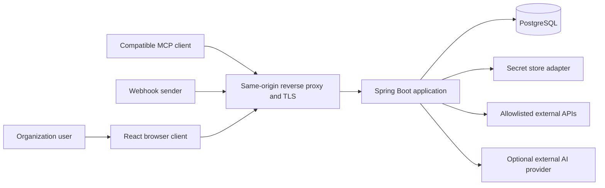
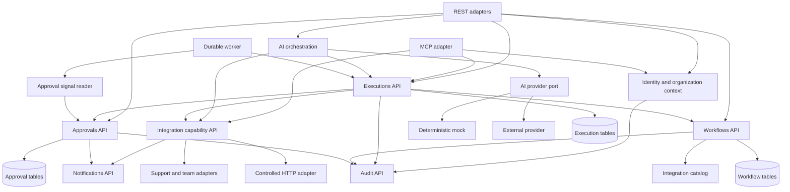

# Proposed system architecture

Status: architecture retained after review. Phase 1 implements foundation, identity and organization onboarding/browser boundaries. Phase 2 implements workflow definitions, HTTP lifecycle and browser authoring; later modules in the target diagrams remain planned. One Spring Boot deployment, one React frontend and PostgreSQL are retained. Phase 3 adds bounded PostgreSQL-backed execution workers in the same deployment. Phase 4 adds human approvals through owned public ports and durable signals. Separate workers and a broker require evidence and an ADR update. [Phase 2 contract](../development/PHASE_2_WORKFLOWS.md).

## Context and containers

Phase 4 implements approvals.domain/application/persistence/web and React inbox/detail/policy UI in the same deployment. Approvals owns the ApprovalExecutionContext public port; executions supplies an authorized adapter and consumes signals through ApprovalRuntime. Neither module imports the other's persistence classes. Mutations lock declared user IDs in sorted order before organization, execution and work. Policy invalidation acquires no execution locks. Human waits hold no worker thread/lease or open transaction. Typed ApprovalAudit participates in lifecycle transactions. No broker, notification dispatcher or external decision URL is introduced. [Exact contracts and verification](../development/PHASE_4_APPROVALS.md).

The browser uses relative `/api/v1` URLs. Vite proxies them in development; the production asset server proxies them to the backend. Container hostnames remain server-side. Detailed management endpoints are private. MCP is disabled until authenticated transport exists.

## Module boundaries

Each module owns entities, repositories and migrations. Callers use public application contracts with DTOs and typed errors. No cross-module entity/repository imports or ORM navigation. Public services enforce authorization even when called from workers, AI or MCP. A small shared kernel holds IDs, safe errors, clock and immutable actor/organization context; it depends on no business module.

| Module | Owns | Permitted dependencies |
| --- | --- | --- |
| identity | Accounts, credentials, sessions, reset and verification | audit |
| organizations | Tenants, membership, roles, permissions, invitations | identity public lookup, audit |
| integrations | Catalog, configuration, controlled HTTP, sample support/team capabilities, receipts | organizations, audit, notifications |
| workflows | Drafts, validation, published snapshots | integration catalog, organizations, audit |
| executions | Runtime states, work, attempts, recovery, operation progress | workflows, integrations, approvals, organizations, audit |
| approvals | Policies, exact approved intent, decisions, durable decision signals | organizations, notifications, audit |
| ai | Provider abstraction, plans, bounded conversations | authorized integration reads, executions, organizations, audit |
| mcp | Protocol, schemas and tool adapters | integration reads, executions, organizations, audit |
| notifications | In-app notifications, delivery attempts, demo email outbox | organizations, audit |
| audit | Append-only safe event writer and restricted queries | shared only |

Organization and identity contexts are explicitly passed, not inferred from worker thread state. Audit query callers must authorize before access; audit's public query method also requires a verified audit-read capability. Platform grants never imply tenant membership.

Approvals do not depend on executions. A decision writes a durable signal. The execution worker reads signals through approvals' public interface, records a consumption receipt and conditionally resumes its own execution. Normal synchronous module transactions share PostgreSQL; no circular service calls are needed. Notification delivery is recoverable work, never the authoritative execution state.

## Component and module dependency diagram

Authorization and auditing apply to all boundaries, including arrows omitted for readability. Tables share a physical database but retain module ownership. Architecture tests will enforce package dependencies once domain code exists.

## Interview rationale

A modular monolith preserves local transaction guarantees while making boundaries explicit enough to extract later. Microservices would add network failure and distributed coordination before the domain is established. Interfaces belong at capability, provider and module boundaries, not on every service.

A distributed transaction tries to coordinate changes in separate systems. PostgreSQL cannot roll back an external API call. BridgeOps persists intent, uses idempotency and reconciles ambiguous outcomes rather than promising global atomicity. Security-sensitive changes write audit records in the same local transaction; notification delivery is asynchronous and recoverable.

The Phase 5 REST increment implements that boundary with execution-owned ExternalDispatch and integration-owned registered-operation planning, dispatch markers and transport. Public application contracts independently rederive persisted actor/tenant/approval/fence context; no integration repository is imported by executions. Network I/O and credential resolution run with transaction propagation NEVER; required dispatch audit commits before I/O and result/receipt/audit commit under the current fence afterward. Explicit USER/AUTOMATION context and signed durable webhook acceptance are implemented in preceding Phase 5 increments; historical scope notes below describe their original checkpoints. Typed authoring and complete preserved-data release verification remain in progress.

Implemented Phase 1D clarification: shared.mail owns the narrow OutboundEmail port and authenticated TLS adapter. Identity and organizations depend on that module-neutral contract; identity does not depend on organization persistence or invitation infrastructure. Member display labels are resolved through identity's public query DTO boundary only after tenant authorization. Planned notifications and workflow execution modules above remain later work.

Phase 2 implements workflows.domain/application/persistence/web and the React workflow editor. WorkflowService calls organizations.application.TenantAuthorization for live tenant capability checks and retained write locks; it imports no identity/organization repository/entity. audit.application.WorkflowAudit is a narrow public writer into the existing append-only tenant audit stream, with typed actions and bounded revision/version/hash metadata; audit query APIs remain deferred. Controllers and browser forms expose drafts, persisted validation, immutable publication/history, independent duplication and archive. No integration catalog dependency is fabricated before connectors exist, and no execution or approval dispatcher is introduced.

Phase 3 implements executions.domain/application/persistence/web, ExecutionWorker and the React execution monitor. WorkflowDefinitions/WorkflowRuntime expose immutable schema/snapshot contracts; executions never imports workflow, identity or organization repositories/entities. Live browser mutations and trusted worker dispatch use public tenant/actor boundaries, with actor → organization → execution → work lock ordering for effects and reconciliation. Claim admission commits a lease/fence before preparation outside a transaction; internal record effects, receipts and results then share a short fenced transaction. PostgreSQL remains execution truth, and the pool/timer are bounded process machinery only. No approvals/integrations/notifications dispatcher or broker is introduced. [Runtime contract](../development/PHASE_3_EXECUTION.md).

Phase 5 extends that engine through execution-owned CapabilityDispatch and ExecutionEffects application contracts. The integration gateway independently rederives persisted fenced context, validates live connection/operation/authority/approval and performs the delivered internal ticket/team reads, protected assignments/notes and internal notification delivery. Integration-owned receipts and execution-owned attempt/result/route/timeline changes share the short local transaction. Actor-set changes force release/recheck rather than locking a new identity after the organization. No cross-module repository/entity imports or second execution engine are introduced. Business mutations use exact human approval and revision compare-and-set; effects/receipts/business audit/results share the fenced transaction. Decision-time operation checks rederive the pinned context using the deciding human and avoid requester locks after the organization. External calls and actual automation/webhooks remain later Phase 5 increments; network work must stay outside database transactions when those adapters are delivered. [Current scope and verification](../development/PHASE_5_INTEGRATIONS.md).
