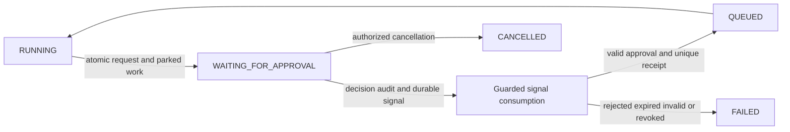

# Phase 4 — real human approval processing

Status: complete and verified locally and in corresponding hosted implementation CI, 2026-10-19. Historical preflight verified clean local/fetched master b2985dd3d178d9fddda59f163d762de8b0ce0270 and [successful corresponding CI](https://github.com/ChouaibSeishin/BridgeOps/actions/runs/39070809279). Preflight Compose was healthy on V10; the verified upgrade is now healthy on V11. Preserved aggregate local data: one user, organization and membership, three workflows, two published versions, no executions/receipts, consumed bootstrap marker. Private fingerprints cover identity/tenant/workflow/execution tables, environment/signing material and named-volume identity. Never use these as test fixtures.

## Accepted contract

Schema/canonicalization v1 remain unchanged. An explicit approval node protects its immediately following syntheticAction/record; approval → approval/end or any ambiguous unsupported target rejects submission with 422 INVALID_APPROVAL_TARGET before persistence. Prompt is display context, not authority. Exact intent binds tenant, execution, gate/action IDs, immutable version/hash, requester, logical operation, capability/operation, exact bounded arguments/hash, policy snapshot/version, prompt, creation, expiry and absolute deadline. Application-specific canonical JSON and SHA-256 do not claim an external canonicalization standard.

Organization policy v1 exposes only requireRecordApproval (default false) and lifetimeSeconds (default 3600, bounded 60–86400). Version/revision starts at zero; policy changes require policy.manage, optimistic revision, preserved immutable policy history and transactional audit. Existing fixed role mappings are retained: approval.read for all active tenant roles; approval.decide for Owner/Approver; policy.manage for Owner only. No self-approval, including multi-role owners. Requester-only organizations need a distinct invited approver.

Every synthetic effect passes the central gate, including graphs without approval nodes. Explicit gates always wait regardless of the low-risk default. A unique request per execution/action prevents duplicate explicit/policy gates. Pending requests finalize once as APPROVED/REJECTED/EXPIRED/INVALIDATED/CANCELLED. Final decisions are immutable. A later policy/authority invalidation prevents future dispatch without rewriting an earlier final decision. Policy versions must match at decision, resumption and effect; an old approval never transfers to changed intent.

RUNNING → WAITING_FOR_APPROVAL parks durable work without holding a lease, thread or transaction. Decisions create insert-only signals atomically with decision/audit. The execution module consumes signals through approval application contracts, records unique consumption receipts and conditionally queues only a still-waiting eligible execution. Approval expiry is min(policy lifetime, execution deadline). Original 24-hour deadline never changes. Rejected/expired/invalidated requests safely fail the execution; cancellation retains completed effects and prevents resumption. None of these failures is a manually retryable approved intent.

## Transaction and module boundaries

Approvals owns policy/request/decision/signal/history persistence and imports no execution entity or repository. It defines a narrow execution-context port; executions implements that port using its own store. A decision can lock/check the current execution through this public contract without a circular service dependency. Executions uses public approval gate/signal methods, never approval SQL or repositories. Both share the enclosing short PostgreSQL transaction for atomic transitions.

Preserve actor → organization → execution → work → policy/request/signal lock order. API mutations lock their live caller before the organization, then the execution via the context port before approval rows. Workers must recheck both requester and distinct decider; they pre-read the involved identities and lock that bounded actor set in UUID order before the organization. If the decision actor changed after the pre-read, release/retry before acquiring a newly discovered actor lock; never acquire a new user lock after the organization. Policy updates lock only their caller/organization and their own policy/request rows, never executions or another actor. This avoids reversing existing cancellation/worker locks or holding rows while waiting for human input.

## REST and UI contract

Under /api/v1/organizations/{organizationId}: GET /approvals (page/size/status/executionId), GET /approvals/{id}, POST /approvals/{id}/decision with {expectedRevision,decision:APPROVE|REJECT,reason?}; GET /approval-policy; PUT /approval-policy with {expectedRevision,requireRecordApproval,lifetimeSeconds}. Only the server selects actor/time/intent/policy. Decision returns the actual persisted request and current execution state; approval does not imply effect success. Pagination is bounded to size 1–100/page 0–100000; optional reason ≤200 characters, control characters rejected. Strict JSON, body limits, bearer identity, exact Origin/CSRF and safe 400/401/403/404/409/422/503 behavior follow existing routes. One duplicate/conflicting final decision returns 409, never a second signal. Inaccessible resources remain concealed.

The in-app inbox/detail shows exact stored arguments, source version/hash, actors, prompt, policy, expiry, history and current execution. Decision controls depend on live grants, distinct actor and pending unexpired state; the backend remains authoritative. Execution monitors link to pending approval and retain actual timeline/partial outcomes. Owner-only policy editing exposes implemented fields only. No email, notifications, third-party effect, AI or MCP is introduced.

## Verification and delivery

Each verified increment uses a normal Conventional Commit/push on existing master. Run focused contract, PostgreSQL lifecycle/migration/privilege/race/outage, HTTP and frontend tests, then retain the complete Phase 1–3 and expanded real Chromium journey, strict report gate, production build/container/same-origin checks, dependency and staged/history secret scans. Tests use disposable PostgreSQL/synthetic identities and no real SMTP. Update this guide and project status with actual counts, migration, preservation and hosted outcomes; compilation alone is insufficient. Full completion remains unclaimed until every applicable gate passes.

## Historical verified increments

First increment: six focused ApprovalContractsTest cases passed with zero failures/errors/skips, covering one final disposition, exact escaped Unicode arguments, identity/version/node/operation binding, changed policy/expiry, bounded lifetimes and canonical policy/timestamp precision. Documentation checks passed. Production dispatch remains Phase 3 until the additive schema and guarded runtime increment are verified.

V11 persistence increment: fresh V11 and V10-upgrade cases passed alongside both retained Phase 3 migration cases (four integration cases, zero failures/errors/skips). Historical ExecutionMigrationIT is explicitly pinned to V10, matching the existing V9 workflow-migration pattern; all its assertions remain. The V10 upgrade fixture includes consumed account/tenant/roles, immutable workflow bytes, terminal execution, step/attempt/timeline, durable work and committed effect/receipt, compared unchanged after V11. New schema has tenant-qualified context/step/policy FKs, canonical intent/hash checks, initial-policy matching, single distinct decision guard, one signal/request and one consumption receipt/signal, immutable historical tables and narrow runtime grants. No existing data rows or role mappings are migrated. Runtime support is still being implemented.

Runtime service checkpoint: 11 focused unit/boundary cases plus 49 PostgreSQL cases passed (12 approvals, all 31 retained execution lifecycle and six retained execution HTTP), zero failures/errors/skips. Repeated verification caught and fixed same-clock history ordering: outstanding execution links now select pending/unconsumed requests explicitly, not an arbitrary earlier decision. The retained unsupported-approval fixture now targets approval → end, while positive approval → record is verified by the new vertical slice; rejection/count assertions remain. Worker preparation and effect commit both use the central gate. Waiting work has no lease; decided signals are consumed with execution state/queue changes in one transaction. Eligibility reads allow a safe terminal denial to commit without transaction rollback-only artifacts, while live mutations still fail closed. The approval HTTP and browser adapters remain separate delivery increments. Current local frontend checks pass 67 cases/typecheck; only the updated execution state/error contract accompanies this runtime checkpoint.

## Implemented persistence and recovery

V11 adds approval_policy_versions, organization_approval_policies, approval_requests, approval_decisions, approval_signals, approval_signal_receipts, approval_invalidations and approval_events. Execution/step/work CHECK constraints and the existing transition guard gain approval waits and parked WAITING work. No V1–V10 migration is edited and no historical data/permission rows are updated. Fresh V11 and actual V10 upgrades are tested with a committed record/receipt and byte-for-byte account/tenant/definition/execution history comparisons.

Policy version zero is the effective built-in default; GET does not create a row. First approval use or an Owner update persists the immutable default snapshot, attributed to the system with no fictitious user. Owner changes create version N+1, update the tenant head, finalize pending requests and audit atomically. Expired pending requests finalize as EXPIRED rather than receiving a fresh lifetime. Even a looser new policy cannot carry an old authorization forward.

Requests bind the exact execution context with composite foreign keys, including tenant/version/hash/requester/deadline, the gate step and protected step/logical operation/operation hash. SHA-256 checks bind canonical intent and argument bytes; insert guards bind the policy snapshot to its immutable policy version. Request mutation is limited to one pending-to-final transition with revision 0→1. A distinct-decider trigger and unique request decision constrain SQL as well as services. Signals reference the request's final outcome; consumption receipts reference the same tenant/request/execution signal. Runtime grants deny history updates/deletes/truncation and permit only narrow mutable columns. Ordinary operator UPDATE/DELETE triggers also reject historical mutation. No cleanup job shortens receipt or decision retention in this phase.

Approval arguments have their own canonical hash; the Phase 3 operation argument hash/key remains unchanged. Intent canonicalization sorts the supported fixed policy/intent keys, preserves exact message characters and uses PostgreSQL microsecond timestamp precision. It is application-specific JSON, not a claim of RFC 8785 compliance. Human names are presentation metadata; immutable user UUIDs determine identity and self-approval checks.

The central gate checks execution.run and capability.write separately, plus live requester/account/tenant context. The deciding account and current approval.decide membership are checked again at resume and immediately before the protected effect. Public execution-context reads/locks also authorize their live actor/family, and source metadata uses an authorized workflow summary projection; approval responses contain no full graph or account credential/email fields.



The approval module never writes execution tables. Its context port is implemented by executions using its own store and authorization contracts, without depending on ExecutionRuntime/ExecutionService or creating a service cycle. The execution worker owns QUEUED resumption and queue fencing; decision HTTP never runs a capability. The same short transaction consumes the signal, completes the explicit approval step where applicable, advances the correct position, queues work and appends history/audit. A gate has no active worker attempt during a human wait; valid resumption records its completed governance attempt. A rejected/expired wait never fabricates a protected operation attempt or success.

Crashes before request/wait commit roll back both. A decided-but-unconsumed request remains discoverable after API response/process restart. Once consumed, the receipt prevents another queue transition. If policy starts requiring approval between preparation and effect, the worker records the interrupted preparation and parks before the effect; the old claim is fenced. If interrupted after a committed effect, the existing operation receipt/current position prevents repetition. Cancellation, terminal state, original deadline, changed policy/intent or revoked authority always block future dispatch. Previously completed effects remain recorded. Terminal executions may receive a late signal-consumption history entry, but never transition or resume.

Execution timelines include approval creation/wait, observed signal outcome/consumption, governance step completion and resumption. Per-request history records the actual request/decision/invalidation/expiry/cancellation and consumption; immutable decisions retain the original actor/time/reason. Approved historical decisions are not rewritten if later policy or authority blocks a future effect; invalidation metadata and the execution failure explain the outcome.

## Exact API and browser behavior

| Method / organization-relative path | Result | Authority |
| --- | --- | --- |
| GET approvals | Page of bounded requests, optional status/executionId | approval.read |
| GET approvals/{id} | Exact stored arguments/hash, policy, source summary, participants, history, decision, execution state and actionable hint | approval.read |
| POST approvals/{id}/decision | 200 actual committed APPROVED/REJECTED request, current execution still waiting until worker consumption | approval.decide and distinct actor |
| GET approval-policy | Effective version/revision, requireRecordApproval, lifetimeSeconds | approval.read |
| PUT approval-policy | 200 committed next version; stale revisions conflict | policy.manage |

Public paths use the existing /api/v1/organizations/{organizationId} prefix. Decision body is exactly {expectedRevision,decision,reason?}; policy body is exactly {expectedRevision,requireRecordApproval,lifetimeSeconds}. No request can set actor/time/intent/arguments/policy version. Explicit null/string/fractional revisions, coerced booleans/numbers, duplicate keys and unknown fields fail 400; invalid bounded policy values fail 422 INVALID_APPROVAL_POLICY. Body limit remains 256 KiB even on direct/chunked backend requests. Reason is at most 200 characters without ISO controls; omit an empty optional reason. List page 0–100000, size 1–100; request events are bounded to 100 (the current lifecycle creates far fewer).

Self-decision is 403 SELF_APPROVAL_FORBIDDEN, including multi-role Owners. Inaccessible/foreign resources remain 404. Stale/repeated decisions return 409 APPROVAL_CONFLICT; expiry returns 409 APPROVAL_EXPIRED; incompatible execution/intent/policy returns safe 409 codes. Unsupported approval topology rejects execution with 422 INVALID_APPROVAL_TARGET before insertion. Missing identity, unsafe Origin/CSRF and dependency outage retain 401/403/503. Error responses never contain SQL, exception text, credentials or arbitrary graph data. Approval rows cannot be used to retry rejected/expired/invalidated intent as though it were approved.

Organization detail exposes Open approvals. Inbox filters persisted states; execution-filtered history includes terminal decisions. Detail displays exact read-only arguments, immutable version/hash, human participant labels with technical UUIDs, actual policy/deadlines and persisted events. Only actionable requests expose confirmable decisions; stale/conflicting errors refresh actual server state. Execution monitoring shows WAITING_FOR_APPROVAL and its request/expiry, and retains a history link after completion. Polling is bounded and stops on terminal detail/error; an empty pending inbox polls more slowly for discovery. Owner policy editing exposes only the enforced v1 fields, retains stale drafts until explicit reload and warns that changes invalidate pending requests. Approval acceptance is never shown as execution success.

## Commands and observed acceptance

Use the existing Java 21 / pinned Node 24.22.0 / Docker / installed Chromium setup in README. From repository root:

```powershell
npm.cmd --prefix frontend ci --no-audit --no-fund
npm.cmd --prefix frontend run typecheck
npm.cmd --prefix frontend run lint
npm.cmd --prefix frontend test
npm.cmd --prefix frontend run build
npm.cmd --prefix frontend exec -- playwright install chromium
./backend/mvnw.cmd -f backend/pom.xml -B -ntp clean verify
node scripts/verify-test-reports.mjs
node scripts/verify-docs.mjs
npm.cmd --prefix frontend audit --omit=dev --audit-level=high
gitleaks git --staged --redact --no-banner
gitleaks git --redact --no-banner
docker compose --env-file .env -f infra/compose.yaml config --quiet
docker compose --env-file .env -f infra/compose.yaml up --build -d --wait --wait-timeout 180
```

Set BRIDGEOPS_TEST_NODE to the absolute pinned Node executable if host Node differs. Focused tests may select ApprovalLifecycleIT, ApprovalHttpIT, ApprovalMigrationIT and ApprovalBrowserIT using the existing failsafe lifecycle; full verify retains every prior suite. Historical V9/V10 migration cases stay explicitly version-targeted. The report gate requires both browser journeys and all execution/approval suites and rejects any failures/errors/skips. Compose commands above upgrade the existing volume/environment; do not rerun setup/bootstrap or reset credentials. Production must still separate migration/operator credentials from the application runtime.

The first complete candidate subset passed 59 integration/browser cases: 39 approval lifecycle, seven approval HTTP, both real browser journeys and 11 retained workflow HTTP cases, zero failures/errors/skips. The approval browser used an isolated organization, distinct authenticated requester/reviewer, real publication/start/decision APIs and the live bounded worker. It verified six executions (two successes, three failures, one cancellation), six requests/signals/consumption receipts, three immutable decisions, four policy versions and seven committed internal records/operation receipts. It exercised self-approval/role/tenant denial, stale decisions, rejection, expiry through a protected test-only clock seam, policy invalidation, node-omission policy enforcement, cancellation, refresh/navigation and desktop/dark/mobile layouts. No real user/account/volume or SMTP was used. Later security/metadata refinements passed the final clean regression below. The exact corresponding implementation run subsequently passed, as recorded below.

Two legacy assertions expected approval tables not to exist. V11 necessarily supersedes that schema expectation: the retained workflow HTTP and Phase 1–3 browser cases now assert zero requests/decisions/signals for their unpublished/unsupported/ordinary fixtures, while retaining all denial and execution-count assertions. The initial schema hosted run failed those assertions; they were corrected explicitly, not skipped or weakened. The original phase-specific migration assertions remain intact at V9/V10, and new V11 upgrade coverage is additive.

Historical documentation correction: Phase 3's hosted-secret-scan wording was inaccurate; its Gitleaks staged/history scans ran locally, while CI had no secret-scan step. Phase 4 explicitly adds full checkout history and Gitleaks 8.30.1, pinned to the official Linux archive SHA-256 551f6fc83ea457d62a0d98237cbad105af8d557003051f41f3e7ca7b3f2470eb. Hosted success is claimed only after that step and the whole corresponding run complete. Existing frontend, backend, browser, migration, report, container, same-origin and dependency gates remain enabled.

## Remaining boundaries

Only internal synthetic.record effects run. No external ticket/team/notification effect, generic network/SQL connector, webhook, email approval, public decision URL, AI/MCP, custom role editor, two-approver quorum, branch/join execution or draft TEST snapshots is implemented. An organization with only its requester must invite a different eligible member; it cannot bypass self-approval. SMTP configuration remains external and unchanged; this phase sends no real messages. There is no distributed exactly-once claim, production HA/load/security/WCAG certification or retention/backup job. Phase 5 will add controlled integrations on this same authorization/approval boundary.

## Local release verification — 2026-10-19

Clean Maven verify completed BUILD SUCCESS: **265 tests, zero failures/errors/skips across 30 XML reports** (61 unit/MVC + 204 required PostgreSQL/browser). The strict report gate passed. This includes 41 approval lifecycle cases, eight approval HTTP cases, two approval migration cases, six canonical/state contract cases, a module-boundary case and the new real approval browser journey, alongside all retained Phase 1–3 suites. Fresh V11 and V10 upgrades passed; historical V9/V10 tests retain their original assertions. Both full Chromium journeys passed using disposable databases, including the six persisted approval scenarios and their final exact record/decision/signal/receipt counts.

All **68 frontend tests**, strict typecheck, lint and production build passed. Production npm audit found zero vulnerabilities. Documentation verification passed 46 Markdown files, 149 local links, seven Mermaid blocks and 14 ADRs; that checker validates structure/links/fences, not diagram rendering or application security. Desktop/mobile/dark captures were visually inspected: [approval inbox](../screenshots/phase4-approval-inbox-desktop.png), [exact intent](../screenshots/phase4-approval-detail-desktop.png), [dark](../screenshots/phase4-approval-detail-dark.png), [mobile](../screenshots/phase4-approval-detail-mobile.png), [execution](../screenshots/phase4-approval-execution-desktop.png). These contain only disposable test identities/data.

The actual existing Compose installation was rebuilt and upgraded to V11 with all three services healthy. Private before/after table fingerprints, environment/signing/CSRF hashes and named-volume identity matched. Aggregate preserved counts remain users/organizations/memberships 1 each, workflows 3, versions 2, executions/approval requests 0; bootstrap remains consumed. Read-only probes confirm denied runtime mutation of decision/signal/consumption history and intent columns, plus denied user INSERT. The production jar contains approval runtime classes and excludes checked test fixtures; built browser assets exclude test-only clock/mail/failure routes. Anonymous actual-nginx smoke passed current approval assets, protected navigation, empty persistent credential storage, health/info/CSRF bootstrap, approval/policy reads 401 and decision POST/policy PUT missing-CSRF or hostile-Origin 403. No local-account login, real mail, bootstrap or test effect was used.

Normal published increment evidence preceding this delivery:

| Commit | Increment | Observed hosted result |
| --- | --- | --- |
| a91a6504da8cf3897460dd693ef224c4aa1339ab | Exact intent/state contracts | [Passed](https://github.com/ChouaibSeishin/BridgeOps/actions/runs/39281116959) |
| 06d4cfe2067bc025f003b6e8edf08cccac41add6 | Additive V11 immutable approval schema | [Failed](https://github.com/ChouaibSeishin/BridgeOps/actions/runs/39281955204): two legacy table-absence expectations, subsequently adapted and verified |
| f883a62eb2f8d2e15d9cf7b7e58f7104e677bc61 | Guarded runtime, central policy and signal resumption | [Failed](https://github.com/ChouaibSeishin/BridgeOps/actions/runs/39286326811): the same two retained table-absence expectations, corrected in the HTTP/UI acceptance increment |

Implementation commit **5d34fbad5c87a521417e491fa2fc474c20c78938** was normally pushed to master and its exact remote ref verified. [Hosted CI completed successfully](https://github.com/ChouaibSeishin/BridgeOps/actions/runs/39294922314), including 265 tests across 30 reports with zero failures/errors/skips, 68 frontend tests/typecheck/lint/build, full-history secret scan, documentation structure, production container startup, same-origin smoke and zero-vulnerability dependency audit. Job logs confirmed the report totals, Gitleaks no-leaks result, build success and audit result. The final documentation checkpoint references this observed implementation run; its own hosted CI is verified separately. Final documentation verification passed 46 Markdown files, 156 local links, seven Mermaid blocks and 14 ADRs.
